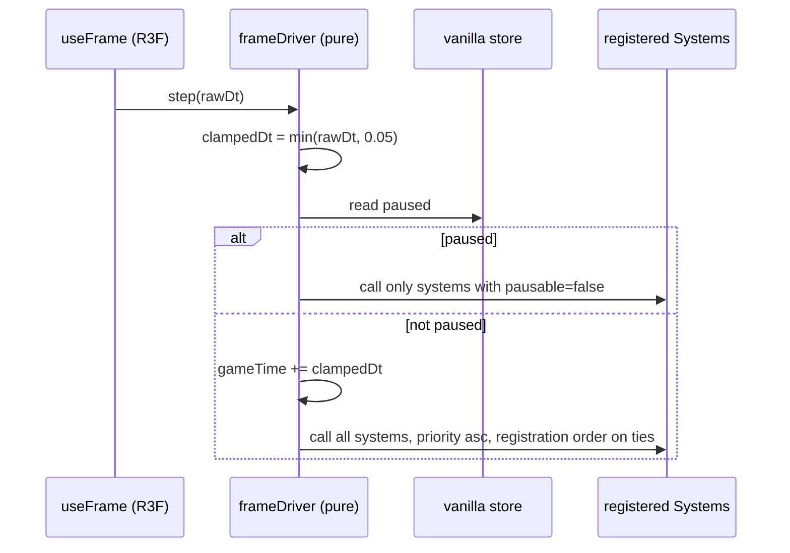

# Design: engine-core

## Overview

This spec builds the shared engine layer every act plugs into: a priority-ordered frame loop, input mapping, mouse look, pointer lock and pause handling, the vanilla game store, settings persistence, player movement (walk, zero-g, seated), capsule-vs-box collision, cutscene timelines with camera shots and shake, scripted look-at, act ordering, the act loader with checkpoints and cleanup, and a dev-only sandbox act that exercises all of it. It adds no menus, art style, audio or real acts.

The design keeps a hard line between pure logic (movement, collision, timelines, input mapping, settings parsing, act order, the frame-driver's internal bookkeeping) living in plain `.ts` files with no Three.js or React import, and the thin React/R3F layer that wires that logic to rendering and DOM events. The game loop reads and writes the vanilla zustand store directly; nothing per-frame goes through React state.

## Architecture

```
src/
  types.ts                         ActId, shared types used across modules
  engine/
    frameDriver.ts                 pure system registry + ordering + dt clamp + accumulation
    FrameDriver.tsx                R3F component: single useFrame, drives frameDriver
    store.ts                       vanilla zustand store, selectors, setters
    settings.ts                    pure settings defaults, clamp, parse, serialize
    persistence.ts                 localStorage read/write wrapper (try/catch), wires settings.ts to store.ts
    input.ts                       pure input state machine (key map, held/pressed, mouse-look math, lock guard filter)
    Input.tsx                      DOM listeners (keydown/up, mousemove, blur, visibilitychange, pointerlockchange, mousedown/up), calls into input.ts, writes refs/store
    pointerLock.ts                 pure pause-trigger decision function (lock state, escape, hidden, debug flag) -> next paused state
    PointerLockController.tsx      wires DOM events + canvas ref to pointerLock.ts and store
    playerBody.ts                  pure Player_Body type, eye position, set(partial)
    movement.ts                    pure walk/zeroG/seated step functions, launch()
    collision.ts                   pure capsule-vs-box resolution
    actOrder.ts                    pure ACT_ORDER array, nextAct()
    actLoader.ts                   pure-ish loader state machine (status, token, checkpoint resolution) + side-effecting loadAct() that calls a pluggable `importAct(id)`
    cleanupRegistry.ts             pure-ish registry: register/runAll (reverse order, catches + logs)
  interaction/
    handrail.ts                    pure distance-based usability check
    focus.ts                       pure focus/look-at progression math
    Focus.tsx                      wires focus.ts into the frame loop and camera/player yaw-pitch
  timeline/
    timeline.ts                    pure Timeline event-firing, camera key interpolation, shot selection, shake
    TimelinePlayer.ts               thin runtime object: holds a Timeline, advances via frameDriver, exposes skip()
  acts/
    sandbox/
      index.ts                     Act_Module: id, checkpoints, Scene, start()
      scene.tsx                     room, boxes, ramp, zero-g zone, seat, test timeline trigger
    placeholders.ts                placeholder Act_Module factory for the other five act ids
  app/
    App.tsx                        (extended) mounts FrameDriver, Input, PointerLockController, Canvas, loaded act's Scene
    debug.ts                       (extended) installDebug adds store/loader/player/focus/lock-test-helper
  content/
    (unchanged; sandbox adds no text)
```

Dependency direction: `acts/*` import from `engine/`, `interaction/`, `timeline/` and `procgen/` (future spec). Acts never import each other. `app/` imports from `engine/` and `acts/` (only to register placeholders and the sandbox) but contains no game logic itself.

### Frame loop sequencing



### Act load sequencing

```mermaid
sequenceDiagram
    participant Caller
    participant Loader as actLoader
    participant Cleanup as cleanupRegistry (old act)
    participant Import as importAct(id)
    participant Mod as new Act_Module

    Caller->>Loader: loadAct(id, checkpoint?)
    Loader->>Loader: token = ++latestToken; status = 'loading'
    Loader->>Cleanup: runAll() for currently active act
    Loader->>Import: import(id)
    Import-->>Loader: Act_Module (or rejects)
    alt token is still latest
        Loader->>Mod: start(resolvedCheckpoint)
        Loader->>Loader: status = 'ready'; store.act/checkpoint set
    else superseded
        Loader->>Loader: drop result, do nothing further
    end
```

## Components and Interfaces

### `engine/frameDriver.ts` (pure)

```ts
export interface SystemHandle { priority: number; order: number; fn: (dt: number, t: number) => void; pausable: boolean }
export function createFrameDriver(getPaused: () => boolean): {
  register(name: string, priority: number, fn: (dt: number, t: number) => void, opts?: { pausable?: boolean }): () => void
  step(rawDt: number): void
  getGameTime(): number
}
```

- Maintains a mutable array of `SystemHandle`, sorted lazily (or kept sorted on insert) by `(priority, order)`.
- `step` clamps `dt`, reads `paused` once, iterates a snapshot of the current handle array (so mid-frame unregister cannot corrupt the current iteration), skips `pausable` handles while paused, and only advances the internal `gameTime` accumulator when not paused.
- `FrameDriver.tsx` creates one `frameDriver` instance at module scope (or via a ref held for the app's lifetime), calls `driver.step(delta)` inside a single `useFrame`, and is the only `useFrame` call in the app.

### `engine/store.ts`

```ts
export interface GameState {
  screen: Screen; act: ActId | null; checkpoint: string | null; paused: boolean
  moveMode: 'walk' | 'zeroG' | 'seated'; objective: string | null; target: string | null
  anomaliesSeen: string[]; settings: Settings; unlockedActs: ActId[]
  setScreen, setAct, setCheckpoint, setPaused, setMoveMode, setObjective, setTarget,
  addAnomalySeen(id: string), setSettings(partial), setUnlockedActs(ids)
}
export const gameStore = createStore<GameState>(...)
```

`addAnomalySeen` is the only mutator with non-trivial logic: it appends `id` only if absent (dedup-insert), preserving existing order.

### `engine/settings.ts` (pure)

```ts
export interface Settings { sensitivity: number; volume: number; subtitleScale: number; reducedMotion: boolean }
export const SETTINGS_DEFAULTS: Settings
export const SETTINGS_RANGES: { sensitivity: [0.2, 3]; volume: [0, 1]; subtitleScale: [0.8, 1.6] }
export function clampSetting(key, value: unknown, previous: number): number
export function clampReducedMotion(value: unknown, previous: boolean): boolean
export interface SavedShape { settings: Settings; unlockedActs: ActId[] }
export function serializeSaved(saved: SavedShape): string
export function parseSaved(raw: string | null): SavedShape   // never throws; always returns a fully valid SavedShape
```

`parseSaved` is the single hardening boundary: malformed JSON, non-object JSON, wrong types, out-of-range numbers, and bad `unlockedActs` entries are all handled field-by-field, falling back to `SETTINGS_DEFAULTS` per field and sanitizing `unlockedActs` to known `ActId`s with `act0-pad` always present.

### `engine/persistence.ts`

Wraps `window.localStorage.getItem`/`setItem` in try/catch, calling `parseSaved`/`serializeSaved`. On any thrown error or when `localStorage` is `undefined`, it logs nothing player-visible and continues with the current in-memory state. Subscribes to the store (`settings`, `unlockedActs`) and writes on change; reads once at startup before the store's initial consumers run.

### `engine/input.ts` (pure state machine)

```ts
export type Action = 'forward'|'back'|'left'|'right'|'use'|'lookBack'|'holdBreath'|'closeEyes'|'wrist'|'pause'
export const KEY_MAP: Record<string, Action>   // KeyW -> forward, ... Escape -> pause
export interface InputState { held: Record<Action, boolean>; pressed: Record<Action, boolean> }
export function createInputState(): InputState
export function applyKeyDown(state: InputState, code: string): void
export function applyKeyUp(state: InputState, code: string): void
export function clearAllHeld(state: InputState): void
export function endFrame(state: InputState): void   // clears pressed flags
export function applyMouseDown(state: InputState, locked: boolean): void   // sets use held+pressed iff locked
export function applyMouseUp(state: InputState): void

export interface MouseLookState { yaw: number; pitch: number }
export function applyMouseLook(s: MouseLookState, movementX: number, movementY: number, sensitivity: number): MouseLookState
export function filterMouseEvent(movementX: number, movementY: number): boolean   // true if event accepted (|m| <= 400)
export function isWithinLockGuard(lockChangeAtMs: number, nowMs: number): boolean // true while nowMs - lockChangeAtMs < 150
```

`Input.tsx` owns the DOM listeners and a mutable `InputState`/`MouseLookState` pair (refs, not React state), consults `filterMouseEvent` and `isWithinLockGuard` (passing a monotonic clock, `performance.now`, so it is testable with injected time) and the active-Focus flag before calling `applyMouseLook`, and calls `endFrame` from a low-priority (last) system registered with `frameDriver`.

### `engine/pointerLock.ts` (pure)

```ts
export interface LockInputs { lockLost: boolean; wasHeld: boolean; escapePressed: boolean; tabHidden: boolean; debug: boolean }
export function nextPaused(current: boolean, inputs: LockInputs): boolean
```

A single pure decision function folds Requirements 4 and 5's branches: hidden or Escape => true; lock lost while `wasHeld` => true (`debug` does not change this branch); lock lost while never `wasHeld` => unchanged; otherwise unchanged. `PointerLockController.tsx` tracks `wasHeld` itself (set true on the first successful `pointerlockchange` with a locked element), de-duplicates a browser-driven Escape-release and an Escape keydown that land in the same tick by only calling `nextPaused` once per settled state (observed through a single queued decision per animation frame, not per raw event), requests/releases `Pointer_Lock`, and swallows promise rejections from `requestPointerLock()`.

### `engine/playerBody.ts` (pure)

```ts
export const CAPSULE = { height: 1.8, radius: 0.3, eyeHeight: 1.65 }
export interface PlayerBody { pos: Vec3; vel: Vec3; yaw: number; pitch: number; mode: MoveMode }
export function eyePosition(body: PlayerBody): Vec3
export function setBody(body: PlayerBody, partial: Partial<PlayerBody>): PlayerBody
```

`setBody` returns a new object with the given fields overwritten; when `partial.pos` is given and `partial.vel` is not, `vel` is zeroed; all other fields are carried over unchanged.

### `engine/movement.ts` (pure)

```ts
export interface WalkConfig { speed?: number; gravity: number; ground?: (x: number, z: number) => number; boxes?: Box[]; jump?: { takeoffSpeed: number } }
export function stepWalk(body: PlayerBody, input: InputState, dt: number, cfg: WalkConfig): PlayerBody

export interface ZeroGConfig { decayHalfLifeSeconds?: number /* default 0.5 */ }
export function stepZeroG(body: PlayerBody, dt: number, cfg?: ZeroGConfig): PlayerBody
export function launch(body: PlayerBody, dir: Vec3, cfg?: ZeroGConfig): PlayerBody

export interface SeatedConfig { seatForwardYaw: number }
export function stepSeated(body: PlayerBody, yawInputDelta: number, pitchInputDelta: number, cfg: SeatedConfig): PlayerBody
```

`stepWalk` handles ground-height lookup (`ground(x,z)` if provided, else the top of the overlapping `Box`), horizontal movement clamped to `speed` for any combination of held directions, jump trigger only when grounded and `cfg.jump` is set, and gravity integration while airborne; `dt === 0` is checked first and returns `body` unchanged (no allocation needed, but returning a fresh object with identical values also satisfies the property). `stepZeroG` decays `vel` by `exp(-ln(2)/halfLife * dt)` then integrates `pos += vel * dt`. `launch` normalizes `dir` (treating a zero vector as a no-op) and adds `dir * (1.5 * ln(2) / 0.5)` to `vel`. `stepSeated` clamps yaw to `[seatForwardYaw - 100deg, seatForwardYaw + 100deg]` using shortest-angle-aware wrapping and pitch to `[-80deg, 80deg]`, leaves `pos` untouched, and zeroes `vel`.

### `engine/collision.ts` (pure)

```ts
export interface Box { min: Vec3; max: Vec3 }
export interface ResolveResult { pos: Vec3; vel: Vec3; onGround: boolean }
export function resolveCapsule(pos: Vec3, vel: Vec3, boxes: Box[]): ResolveResult
```

Up to 4 passes: each pass finds the Box with the largest overlap against the capsule (treated as a vertical cylinder plus hemispherical caps approximated by an AABB-vs-capsule routine), pushes out along the axis of least penetration, and zeroes `vel`'s component along that axis when it opposes motion (landing zeroes downward `vel` and sets `onGround`; hitting a ceiling zeroes upward `vel`). If after 4 passes overlap remains, the loop stops and returns the best position found without throwing.

### `timeline/timeline.ts` (pure) and `timeline/TimelinePlayer.ts`

```ts
export interface TimelineEvent { at: number; run: () => void }
export interface CameraKey { t: number; position: Vec3; lookAt: Vec3 }
export interface Shot { from: number; to: number; cam: (u: number, t: number) => { position: Vec3; lookAt: Vec3 }; fov?: number; far?: number }
export interface ShakeKey { t: number; amp: number }
export interface TimelineDef { duration: number; events?: TimelineEvent[]; camera?: CameraKey[]; shots?: Shot[]; shake?: ShakeKey[]; onTick?: (t: number) => void }

export function dueEvents(def: TimelineDef, firedCount: number, fromT: number, toT: number): TimelineEvent[]
export function interpolateCamera(keys: CameraKey[], t: number): { position: Vec3; lookAt: Vec3 } | null
export function selectShot(shots: Shot[] | undefined, t: number): Shot | null
export function shakeAmplitude(keys: ShakeKey[] | undefined, t: number, reducedMotion: boolean): number
```

`dueEvents` is driven by a stable sort of `events` by `(at, originalIndex)` computed once; the player tracks how many have fired (`firedCount`) and asks for events with `at` in `(fromT, toT]`, so firing is purely a function of elapsed time regardless of how it is chunked into steps, which is what makes the confluence property hold. `selectShot` ignores shots with `to <= from`, picks the last-listed shot whose `[from, to)` contains `t` (treating adjacent `to === from` boundaries as "owned by the next shot"), and returns `null` outside every shot or when finished. `TimelinePlayer` is a small class wrapping a `TimelineDef`: `step(dt)` advances `t` (only when not paused, via a `pausable: true` system registration), calls `dueEvents` and runs them, calls `onTick`, and flips a `finished` flag at `duration`; `skip()` fires all not-yet-fired events once (in order) and marks finished; a second `skip()` or any `step`/`skip` after `finished` is a no-op for event firing.

### `interaction/focus.ts` (pure) and `interaction/Focus.tsx`

```ts
export interface FocusState { active: boolean; hold: boolean; startYaw: number; startPitch: number; targetFn: () => Vec3; seconds: number; elapsed: number }
export function startFocus(current: { yaw: number; pitch: number }, targetFn: () => Vec3, seconds?: number, hold?: boolean): FocusState
export function stepFocus(state: FocusState, dt: number): { state: FocusState; yaw: number; pitch: number; active: boolean }
export function clearFocus(state: FocusState): FocusState
```

`startFocus` records the current view direction as the start of the turn (used both for a fresh `focusOn` and for replacing an in-progress one, since callers pass the *current*, possibly mid-turn, yaw/pitch). `stepFocus` computes a progress fraction `min(elapsed/seconds, 1)`, turns yaw by the shortest angular path toward the direction to `targetFn()` re-evaluated every step, and reports `active` as `hold ? true : elapsed < seconds` (post-completion with `hold`, it keeps re-evaluating `targetFn()` so it keeps facing a moving target). `Focus.tsx` holds the mutable `FocusState | null` in a ref, registers a `pausable: true` system that calls `stepFocus` and writes the result into the player body's yaw/pitch, and exposes `focusOn`/`clearFocus`/`focus()` through a small controller object referenced by `App.tsx` and `debug.ts`.

### `engine/actOrder.ts` (pure)

```ts
export const ACT_ORDER: ActId[] = ['act0-pad','act1-launch','act2-coast','act3-farside','act4-moon','act5-home']
export function nextAct(id: ActId): ActId | null
```

### `engine/actLoader.ts`

```ts
export interface Act_Module { id: ActId; checkpoints: string[]; Scene: React.ComponentType; start(checkpoint: string): void }
export interface LoaderState { status: 'idle'|'loading'|'ready'|'error'; act: ActId | null; checkpoint: string | null }
export function resolveCheckpoint(checkpoints: string[], requested: string | undefined): string   // pure
export function createActLoader(deps: {
  importAct: (id: ActId) => Promise<Act_Module>
  cleanupRegistry: CleanupRegistry
  store: typeof gameStore
  allowed: (id: ActId) => boolean   // sandbox gating from Requirement 19/5
}): {
  getState(): LoaderState
  loadAct(id: ActId, checkpoint?: string): Promise<void>
}
```

`loadAct` increments a module-scoped `latestToken`, captures its own `token`, sets `status: 'loading'`, synchronously runs the previous act's cleanups (`cleanupRegistry.runAll()`), then `await`s `importAct(id)`. After the import settles, it checks `token === latestToken`; if superseded, it does nothing further (no `start()`, no `status` write), which is what makes only the last call's act end up active. On success it resolves the checkpoint via `resolveCheckpoint`, calls `Act_Module.start(checkpoint)`, writes `store.act`/`store.checkpoint`, and sets `status: 'ready'`. On import rejection (and only if still latest) it sets `status: 'error'`. `importAct` is injected so tests can control resolution timing and failure without real dynamic imports; production wiring in `app/App.tsx` supplies a `Record<ActId, () => Promise<Act_Module>>` of real `import()` calls (one per act id) plus the sandbox, gated by `allowed`.

### `engine/cleanupRegistry.ts`

```ts
export interface CleanupRegistry { register(fn: () => void): void; runAll(): void }
export function createCleanupRegistry(onError?: (e: unknown) => void): CleanupRegistry
```

`runAll` calls registered functions in reverse registration order, catches and logs (via `onError`, defaulting to `console.error`) any throw, and always continues to the remaining functions, then clears the registry. `actLoader` creates one `CleanupRegistry` per currently-active act and swaps it on each `loadAct`. Helper wrappers `registerSystemWithCleanup`, `registerTimerWithCleanup`, `registerListenerWithCleanup` (thin functions in `engine/actLoader.ts` or a small `engine/registerHelpers.ts`) call the underlying `frameDriver.register` / `setTimeout`/`setInterval` / `addEventListener` and push the matching unregister/clear/removeEventListener call onto the act's `CleanupRegistry`.

### Sandbox act and app wiring

`acts/sandbox/index.ts` exports the `Act_Module`; `acts/sandbox/scene.tsx` builds the room, boxes, ramp (via a `Ground_Function`), a zero-g zone volume (a box checked against `eyePosition(body)` each frame, toggling `store.setMoveMode`), a seat, and a `T`-key handler that starts a 6-second `TimelineDef` with two `Shot`s, one `ShakeKey` ramp, and one event, guarded by checking `!timelinePlayer || timelinePlayer.finished` before starting a new one. `acts/placeholders.ts` builds a trivial `Act_Module` per remaining act id with the checkpoint lists from Requirement 16.5 and an empty `Scene`. `app/App.tsx` mounts `FrameDriver`, `Input`, `PointerLockController`, and a `Canvas` that renders `loader.getState().act`'s `Scene` (or nothing, black clear color, when none is loaded); on startup it calls `installDebug()` then, when `isDebug()`, calls `loader.loadAct('sandbox')`, else renders the title text and loads nothing.

## Data Models

```ts
// src/types.ts additions
export type ActId = 'act0-pad'|'act1-launch'|'act2-coast'|'act3-farside'|'act4-moon'|'act5-home'
export type Vec3 = { x: number; y: number; z: number }
export type MoveMode = 'walk' | 'zeroG' | 'seated'
```

All other interfaces are declared next to their logic as shown above; nothing additional needs a central model file. `Vec3` is a plain object (not a Three.js `Vector3`) so pure modules stay free of the `three` import; the thin R3F-facing wrappers convert at the boundary.

## Correctness Properties

*A property is a characteristic or behavior that should hold true across all valid executions of a system-essentially, a formal statement about what the system should do. Properties serve as the bridge between human-readable specifications and machine-verifiable correctness guarantees.*

### Property 1: Frame ordering

For any set of registered systems with arbitrary priorities and registration order, and for any single call to `step`, the sequence of systems actually invoked equals the systems sorted ascending by `(priority, registrationIndex)`, filtered to pausable-eligible systems per Property 3.

**Validates: Requirements 1.1, 1.2**

### Property 2: Unregister stops future calls, mid-frame mutation is safe

For any sequence of registered systems and any point at which `unregister()` is called (including during another system's execution within the same `step`), the frame in progress completes without throwing, and no subsequent `step` call ever invokes the unregistered system again.

**Validates: Requirements 1.3, 1.4, 1.5**

### Property 3: Pausable systems and Game_Time accumulation

For any sequence of raw `dt` values and any sequence of `paused` toggles, (a) each delivered `dt` equals `min(rawDt, 0.05)`, (b) while paused only systems registered with `pausable: false` are invoked, (c) `getGameTime()` after the sequence equals the sum of the clamped deltas of the steps that ran while not paused.

**Validates: Requirements 1.6, 1.7, 1.8, 1.10**

### Property 4: Input held/pressed state machine

For any sequence of key-down, key-repeat, key-up, blur, and `endFrame` operations over the mapped Actions, (a) a key-down on a previously-unheld action sets both `held` and `pressed`, (b) a repeat event on an already-held action never sets `pressed` again, (c) a key-up clears `held`, (d) `endFrame` clears every `pressed` flag regardless of `held`, (e) a blur or hidden event clears every `held` action, and (f) any key code outside `KEY_MAP` never changes any Action's state.

**Validates: Requirements 2.2, 2.3, 2.4, 2.5, 2.6, 2.7**

### Property 5: Mouse-driven use action

For any sequence of mouse-down/mouse-up events interleaved with pointer-lock-held/not-held states, the `use` action is held and marked pressed if and only if the most recent mouse-down occurred while locked and no mouse-up has followed it; mouse-down events while not locked never affect `use`.

**Validates: Requirements 2.8, 2.9, 2.10**

### Property 6: Mouse look formula and accepted-event filter

For any current `yaw`/`pitch`, any `movementX`/`movementY` with `|movementX| <= 400` and `|movementY| <= 400` (boundary at exactly 400 included), and any `sensitivity`, `applyMouseLook` returns `yaw - movementX * 0.002 * sensitivity` and `pitch - movementY * 0.002 * sensitivity`; for any event where either magnitude exceeds 400, `filterMouseEvent` rejects it.

**Validates: Requirements 3.3, 3.5, 3.6**

### Property 7: Lock guard window

For any lock-change timestamp and any later timestamp `now`, `isWithinLockGuard` returns true if and only if `now - lockChangeAt < 150`, using an injected clock value rather than real time.

**Validates: Requirements 3.4, 3.7**

### Property 8: Focus suppresses mouse look

For any accumulated mouse movement, while a Focus is active, applying mouse-look leaves yaw/pitch unchanged.

**Validates: Requirements 3.8, 15.3**

### Property 9: Confluence of split mouse movement

For any two movement events A and B that both fall within the same accepted window (per Property 6/7), applying `applyMouseLook` once with A then once with B yields the same final yaw/pitch as applying it once with the summed movement `A + B`.

**Validates: Requirements 3.10**

### Property 10: Pause-trigger decision

For any current `paused` value and any `LockInputs` (lock-lost flag, was-held flag, escape-pressed flag, tab-hidden flag, debug flag), `nextPaused` returns true when `tabHidden` or `escapePressed` is true, returns true when `lockLost && wasHeld` regardless of `debug`, returns the input unchanged when `lockLost && !wasHeld`, and otherwise returns the input unchanged.

**Validates: Requirements 4.2, 4.3, 4.4, 4.7, 5.1, 5.2, 5.3**

### Property 11: Escape dedup

For any interleaving of a browser-driven pointer-lock-loss notification and an Escape keydown that both result from the same user Escape press within one settled decision point, the resulting `paused` state transitions from false to true exactly once, never toggling back to false within that interleaving.

**Validates: Requirements 4.10**

### Property 12: Anomaly dedup-insert

For any starting `anomaliesSeen` array and any sequence of ids added one at a time via `addAnomalySeen`, the resulting array contains no duplicate entries, each added id appears exactly once, and the relative order of first appearances is preserved.

**Validates: Requirements 6.5, 6.6, 6.7**

### Property 13: Settings setter clamping

For any current numeric setting value and any input value, the numeric setter returns `clamp(input, min, max)` when `input` is a finite number, and returns the previous value unchanged when `input` is not a finite number; for `reducedMotion`, any non-boolean input leaves the previous boolean value unchanged.

**Validates: Requirements 7.2, 7.3**

### Property 14: Settings round-trip

For any valid `SavedShape` (settings within range, `unlockedActs` a subset of known `ActId`s including `act0-pad`), `parseSaved(serializeSaved(x))` equals `x`.

**Validates: Requirements 7.12, 7.14**

### Property 15: Parser robustness

For any arbitrary string (valid JSON, invalid JSON, or valid JSON of the wrong shape), `parseSaved` never throws and returns a `SavedShape` whose every settings field is within its documented range and whose `unlockedActs` contains only known `ActId`s, deduplicated, always including `act0-pad`.

**Validates: Requirements 7.7, 7.8, 7.9, 7.10, 7.13**

### Property 16: Eye position and partial body update

For any `PlayerBody`, `eyePosition(body)` equals `body.pos` offset by `1.65` on the vertical axis. For any `PlayerBody` and any partial update, `setBody` overwrites exactly the given fields, zeroes `vel` when `pos` is given without `vel`, and leaves every other field unchanged.

**Validates: Requirements 8.4, 8.5, 8.6, 8.7**

### Property 17: Walk speed and diagonal clamp

For any configured walk speed and any combination of held forward/back/left/right (including diagonals and opposing pairs), the resulting horizontal speed never exceeds the configured speed, and holding a single direction achieves exactly that speed.

**Validates: Requirements 9.1, 9.2, 9.3**

### Property 18: Pitch clamp invariant

For any sequence of pitch deltas applied over any number of walk steps, the resulting pitch always stays within `[-90, 90]` degrees.

**Validates: Requirements 9.5**

### Property 19: Ground following and no bounce

For any `Ground_Function` or box-top floor, and for any sequence of walk steps while on that floor (flat or sloped) and not jumping, the player's vertical position tracks the floor height each step with no oscillation around it.

**Validates: Requirements 9.6, 9.7, 9.8**

### Property 20: Jump trigger

For any combination of grounded/airborne state and jump-enabled/disabled configuration, pressing the jump trigger sets vertical velocity to the configured takeoff speed if and only if the player is grounded and jumping is enabled; in every other combination, vertical velocity is unchanged by the trigger.

**Validates: Requirements 9.9, 9.10, 9.11**

### Property 21: Gravity integration while airborne

For any gravity value and any airborne starting state, vertical velocity decreases by `gravity * dt` each step while airborne, and stops decreasing (and is zeroed if it was downward) once the feet reach floor height.

**Validates: Requirements 9.4, 9.13**

### Property 22: Zero dt is a no-op

For any `PlayerBody` and any mode/config, calling the corresponding step function with `dt = 0` returns a body equal to the input.

**Validates: Requirements 9.14**

### Property 23: Zero-g ignores directional input, decays and integrates

For any zero-g `PlayerBody` and any combination of held directions, directional input never changes velocity. For any velocity and `dt`, one zero-g step applies `vel *= exp(-ln(2)/0.5 * dt)` then `pos += vel * dt`.

**Validates: Requirements 10.1, 10.2, 10.3**

### Property 24: Launch impulse

For any current velocity and any direction `dir`, `launch(dir)` adds `normalize(dir) * (1.5 * ln(2) / 0.5)` to the velocity; for a zero-length `dir`, velocity is unchanged.

**Validates: Requirements 10.4, 10.6, 10.7**

### Property 25: Launch drift distance across step sizes

For any step size `dt` in `(0, 0.05]`, simulating repeated zero-g steps after a launch from rest until velocity is negligible yields a total drift distance within 5% of 1.5 m.

**Validates: Requirements 10.5, 10.10**

### Property 26: Handrail usability boundary

For any eye position and handrail position, the handrail is usable if and only if the distance between them is at most 2.0 m (boundary at exactly 2.0 m included).

**Validates: Requirements 10.8, 10.9**

### Property 27: Seated clamps and fixed position

For any seat forward direction (including values near the ±180° wrap boundary) and any sequence of yaw/pitch input deltas, after a seated step: position is unchanged, velocity is zero, resulting yaw stays within ±100° of the seat forward direction (shortest-path wrap-aware), and resulting pitch stays within ±80°.

**Validates: Requirements 11.1, 11.2, 11.3, 11.4, 11.5, 11.6**

### Property 28: Collision resolution has no final overlap, is a no-op when already separated, and is idempotent

For any set of boxes that leaves room for the capsule and any starting position, after resolution the capsule overlaps none of the boxes; for any starting position that does not overlap any box, resolution returns that position unchanged; for any starting position, resolving a second time leaves the result unchanged.

**Validates: Requirements 12.2, 12.3, 12.7, 12.8, 12.9**

### Property 29: Sliding along a wall

For any axis-aligned wall box and any approach velocity with a component into the wall and a component along it, resolution preserves the along-wall component and removes the into-wall component.

**Validates: Requirements 12.4**

### Property 30: Vertical landing and ceiling contact

For any box and a capsule approaching from directly above while falling, resolution zeroes the downward velocity and reports `onGround: true`; for a capsule approaching the underside while rising, resolution zeroes the upward velocity.

**Validates: Requirements 12.5, 12.6**

### Property 31: Collision never throws

For any (including degenerate or unresolvable) set of boxes and starting position, `resolveCapsule` returns a finite position within 4 passes and never throws.

**Validates: Requirements 12.10**

### Property 32: Timeline events fire exactly once, in order, regardless of step chunking

For any list of timeline events with arbitrary `at` times (including ties) and any two different sequences of `dt` steps that sum to the same total elapsed time, each event fires exactly once in both runs, in the order given by `(at, originalIndex)` ascending, and the two runs produce the same firing sequence.

**Validates: Requirements 13.3, 13.4, 13.5, 13.12**

### Property 33: onTick called once per step

For any sequence of `dt` steps while a Timeline is active and not finished, `onTick` is called exactly once per step with the Timeline's running time.

**Validates: Requirements 13.6**

### Property 34: Skip semantics

For any Timeline and any point at which `skip()` is called (including a second call, or a call after natural finish), every event that had not yet fired fires exactly once as part of that `skip()`, no event ever fires more than once across the Timeline's lifetime, and no `step` or further `skip` after the first effective skip/finish fires any additional event.

**Validates: Requirements 13.9, 13.10, 13.11, 13.13**

### Property 35: Timeline time does not advance while paused

For any sequence of steps with arbitrary pause toggling, the Timeline's internal time only accumulates the `dt` of steps that ran while not paused.

**Validates: Requirements 13.14**

### Property 36: Camera key interpolation

For any sorted list of camera keys and any query time, the interpolated position/lookAt equals the linear interpolation between the two bounding keys when the time is within range, and equals the nearest key's values when the time is before the first or after the last key.

**Validates: Requirements 13.7, 13.8**

### Property 37: Shot selection

For any list of shots (including overlapping shots and degenerate shots with `to <= from`) and any query time, `selectShot` ignores every degenerate shot, returns the last-listed shot among those whose `[from, to)` range contains the time (with `to === from` of the next shot treated as owned by that next shot), and returns `null` when no shot's range contains the time or when the Timeline has finished.

**Validates: Requirements 14.1, 14.3, 14.4, 14.5, 14.6, 14.7, 14.10, 14.11**

### Property 38: Shot fov/far application

For any shot with `fov` and/or `far` set, while that shot is selected those values are reported alongside its camera result; while no shot is selected, no override is reported.

**Validates: Requirements 14.2**

### Property 39: Shake amplitude interpolation and reduced motion

For any shake keys and any query time, the interpolated amplitude follows the same hold-at-ends interpolation shape as camera keys, and the final reported amplitude is the interpolated value times `0.25` when `reducedMotion` is true and times `1` otherwise; a finished Timeline reports zero shake.

**Validates: Requirements 14.8, 14.9, 14.10**

### Property 40: Focus progression reaches the target within tolerance

For any starting yaw/pitch, any (possibly time-varying) target function, and any `seconds`, stepping a Focus to completion (`elapsed >= seconds`) results in a view direction equal to the direction toward `targetFn()` evaluated at that moment, within `0.001` rad; the target function is re-evaluated every step rather than only at start.

**Validates: Requirements 15.1, 15.2, 15.11**

### Property 41: Focus hold/clear semantics

For any `seconds`/`hold` combination, once elapsed time reaches `seconds`: if `hold` is false, `active` becomes false; if `hold` is true, `active` stays true (and the view keeps tracking the target) until `clearFocus()` is called, at which point `active` becomes false regardless of `hold`.

**Validates: Requirements 15.4, 15.5, 15.6**

### Property 42: Focus replacement starts from current direction

For any Focus in progress and a new `focusOn` call that replaces it, the new Focus's starting direction equals the in-progress view direction at the moment of replacement, not the original Focus's starting direction.

**Validates: Requirements 15.7**

### Property 43: Shortest-path yaw turning

For any starting yaw and any target yaw, the angular delta chosen by the Focus progression has magnitude no greater than 180 degrees.

**Validates: Requirements 15.9**

### Property 44: Focus time does not advance while paused

For any sequence of Focus steps with arbitrary pause toggling, the Focus's internal elapsed time only accumulates the `dt` of steps that ran while not paused.

**Validates: Requirements 15.10**

### Property 45: Act order traversal

For any act id in `ACT_ORDER` other than `act5-home`, `nextAct(id)` returns the following id in the order; `nextAct('act5-home')` returns `null`.

**Validates: Requirements 16.2, 16.3**

### Property 46: Checkpoint resolution

For any list of checkpoints and any requested checkpoint (valid member, invalid string, or `undefined`), `resolveCheckpoint` returns the requested checkpoint when it is a member of the list, and returns the first checkpoint otherwise.

**Validates: Requirements 17.4, 17.5**

### Property 47: Act load lifecycle and store writes

For any act id and resolvable `importAct`, calling `loadAct` transitions status from `'loading'` to `'ready'`, writes `store.act` and `store.checkpoint` to the resolved act id and checkpoint, and calls the new `Act_Module.start` with that checkpoint exactly once.

**Validates: Requirements 17.2, 17.3, 17.11**

### Property 48: Overlapping loadAct calls, only the last wins

For any sequence of overlapping `loadAct` calls with controllable (mocked) import resolution timing, every call except the last-issued one has no observable effect on the final state (its act's `start` either never runs, or if it had already run, its act is cleanly superseded), the final `status` is `'ready'` with the last call's act and checkpoint, and at every sampled point during the sequence at most one Act_Module is observably active.

**Validates: Requirements 17.7, 17.8, 17.9, 17.10, 17.12**

### Property 49: Cleanup runs exactly once, in reverse order, tolerating throws

For any sequence of registered cleanup functions, some of which may throw, calling `runAll()` invokes every registered function exactly once, in the reverse of their registration order, continues past any thrown error (logging it), and itself never throws.

**Validates: Requirements 18.2, 18.3, 18.4**

### Property 50: Unload resets Timeline, Focus, and store fields

For any active Timeline and/or Focus state and any prior `moveMode`/`objective`/`target` store values, after an act unloads: the Timeline (if any) is finished, the Focus (if any) is inactive, and `moveMode`/`objective`/`target` equal `'walk'`/`null`/`null`.

**Validates: Requirements 18.6, 18.7**

### Property 51: System count returns to baseline after load/play/unload

For any act module that registers an arbitrary number of systems, timers, and listeners during `start()` using the cleanup-registering helpers, the count of active frame-driver systems after that act unloads equals the count before it was loaded.

**Validates: Requirements 18.8**

### Property 52: Sequential loadAct ordering

For any `loadAct` call issued while another act is currently loaded, every cleanup of the previously active act completes before the new act's `start()` begins.

**Validates: Requirements 18.9**

### Property 53: Zero-g zone toggles move mode on enter/leave

For any sequence of eye positions relative to the sandbox's zero-g zone volume, `moveMode` becomes `'zeroG'` while the eye is inside the volume and reverts to `'walk'` once the eye leaves it.

**Validates: Requirements 19.7**

### Property 54: Sandbox test timeline is a singleton

For any sequence of `T` key presses, at most one instance of the 6-second test Timeline is ever active at a time; pressing `T` while one is already running has no effect.

**Validates: Requirements 19.9, 19.10**

## Error Handling

- **localStorage failures** (`engine/persistence.ts`): every read and write is wrapped in try/catch; a thrown error or `localStorage === undefined` falls back to defaults in memory and does not throw out of `persistence.ts`. No player-visible error surface exists for this; it is logged via `console.warn` once per failure kind to aid debugging without being a hook.
- **Malformed saved data** (`engine/settings.ts`): `parseSaved` never throws regardless of input; it is the single hardening boundary described in Property 15.
- **Pointer lock request rejection** (`PointerLockController.tsx`): `element.requestPointerLock()` returns a Promise in some browsers; its rejection is caught and ignored (the controller stays paused, matching Requirement 4.8), never surfacing an unhandled rejection.
- **Act import failure** (`engine/actLoader.ts`): a rejected `importAct(id)` call, if still the latest token, sets `status: 'error'` and leaves the previous act's cleanup already run (no half-started act); the rejection itself is caught inside `loadAct` and never propagates to the caller as a thrown error from a dynamic import going unhandled. `loadAct`'s returned Promise still resolves (not rejects) so callers that don't await don't need a catch handler; callers that do await get a resolved Promise and should check `getState().status`.
- **Cleanup function throws** (`engine/cleanupRegistry.ts`): each cleanup is invoked inside its own try/catch; a throw is logged (`onError`, default `console.error`) and `runAll` continues with the remaining cleanups in reverse order.
- **Collision cannot fully separate in 4 passes** (`engine/collision.ts`): the loop simply stops after 4 passes and returns the best position found; this is treated as an expected outcome for degenerate level geometry, not an error, and is covered by Property 31 (never throws).
- **Dt spikes** (`engine/frameDriver.ts`): a raw `dt` far larger than one frame (e.g. after a tab was backgrounded without triggering the hidden-tab pause path, or a slow first frame) is clamped to 0.05 s before any system sees it, bounding the worst-case single-step movement or physics error.

## Testing Strategy

**Dual testing approach.** Unit tests (Vitest) cover concrete examples, API shape, defaults, and wiring that does not benefit from randomization (store shape, act-module shape, DOM-event side effects like `requestPointerLock()` being called, the sandbox's static geometry, app bootstrap branches). Property tests (`fast-check`, already a dependency) cover every property listed above, each as a single property-based test configured for a minimum of 100 runs, tagged with a comment referencing its design property number, e.g.:

```ts
// Feature: engine-core, Property 14: parseSaved(serializeSaved(x)) == x for valid SavedShape
```

**Why PBT applies here.** Nearly all of this spec's logic is pure functions over structured inputs (frame scheduling, input state machines, movement, collision, timelines, settings parsing) with large input spaces where edge cases (boundary angles, zero-length vectors, degenerate boxes, overlapping shots, out-of-range numbers, malformed JSON) are exactly what randomized testing is good at finding. The small remaining slice that is not pure logic — DOM wiring, dynamic `import()` chunking, the real headless-browser flow — is explicitly out of scope for PBT and is covered by example/unit tests and by `e2e/engine.mjs` instead, per `testing.md`.

**Property test generators, by area:**
- *Frame driver / cleanup*: `fc.array` of system descriptors `{ priority: fc.integer(), pausable: fc.boolean() }`, plus `fc.array` of `dt`/`paused` tuples for the accumulation properties.
- *Input*: `fc.array` of `{ type: 'down'|'up'|'repeat'|'blur', code: fc.constantFrom(...knownCodes, ...fc.string()) }` event sequences.
- *Mouse look*: `fc.float` for `movementX`/`movementY` with explicit boundary cases at ±400 included via `fc.constantFrom` mixed into the arbitrary, `fc.float` for yaw/pitch/sensitivity.
- *Settings*: `fc.string()` unconstrained (for `parseSaved` robustness), and a dedicated `fc.record` generator for valid `SavedShape` (for the round-trip property).
- *Movement*: `fc.record` for `PlayerBody`, `fc.boolean` tuples for held directions, `fc.float` for `dt`/speeds/gravity, with explicit `dt = 0` and zero-vector cases folded into the arbitrary via `fc.oneof`.
- *Collision*: a custom generator that places a small number of non-overlapping or deliberately-overlapping axis-aligned boxes and a capsule start position, including degenerate (zero-size or fully enclosing) boxes for the robustness property.
- *Timelines*: `fc.array` of `{ at: fc.float(), }` events with duplicate `at` values permitted, plus a second generator that splits a given total time into an arbitrary partition of `dt` steps (for the confluence property).
- *Focus/seated*: `fc.float` over a full circle (including values beyond ±180° to exercise wraparound) for yaw-related properties.
- *Act loader*: a fake `importAct` built from `fc`-driven resolve/reject delays (represented as an ordering of which call resolves first) to drive the overlapping-call race property deterministically within a test.

**Unit tests, by area:** store initial state and setter shapes; `Act_Module` shape and the placeholder checkpoint lists; `ACT_ORDER` traversal reaching `act5-home` in exactly 5 steps; Capsule constants; Settings defaults; key-map table (ten key codes to their Actions); debug-mode gating of sandbox loading (`?debug` present vs absent); `window.__los.player.body` null-before/shape-after act load; `requestPointerLock()` called on canvas click, and its rejection being swallowed; app bootstrap's two top-level branches (debug loads sandbox and defines `window.__los`; non-debug shows the title and does not). `e2e/engine.mjs` (Requirement 22) covers everything that needs a real browser: real key presses, wall collision from the player's perspective, the zero-g drift distance in situ, the lock-loss/pause/resume flow, and the double `loadAct('sandbox')` race in a real environment.
