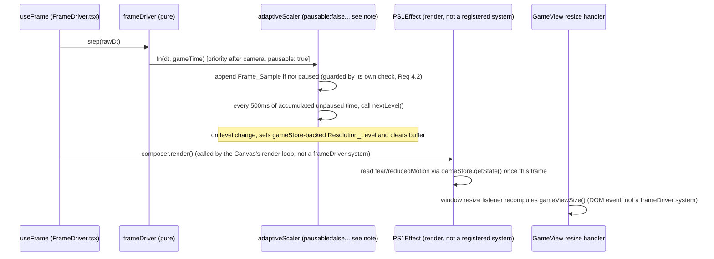
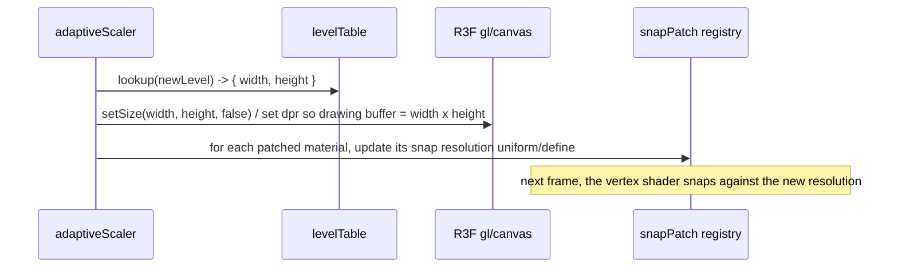

# Design: render

## Overview

This spec gives LOSS OF SIGNAL its PS1-era look while keeping the frame rate up. It adds a low-resolution drawing buffer with a pixelated CSS upscale inside a letterboxed 16:9 Game_View, an adaptive resolution scaler driven by a pure step-up/step-down decision function, a single `postprocessing` Effect that applies chromatic fringing, vignette, gamma-space film grain and 6-bit ordered-dither quantization, a vertex-snapping patch applied through `onBeforeCompile`, a Material_Factory that is the only way acts create materials, scene fog, procedurally drawn and cached canvas textures driven by a seeded RNG, and a debug stats box wired into the existing Debug_Contract. It retextures the `sandbox` act from `engine-core` to use all of this, superseding `engine-core` requirement 19.11.

The design keeps the same hard line `engine-core` established: pure logic (level table lookup, the adaptive decision function, Game_View sizing, fear-to-look-params mapping, the Bayer matrix and quantize/gamma maths, the vertex-snap maths, the seeded RNG, texture pixel generation, fog-spec validation, stats smoothing) lives in plain `.ts` files with no Three.js or React import, so it is unit- and property-testable without a renderer. The thin Three.js/R3F layer (the Effect's shader, the material patch, the canvas/texture upload, the `postprocessing` `EffectComposer` wiring) calls into that pure logic every frame but is itself driven by the single existing `useFrame` in `FrameDriver.tsx`; nothing here adds a second `useFrame` or routes per-frame state through React.

## Architecture

```
src/
  render/
    levelTable.ts          pure Level_Table, lookup(level), LEVEL_COUNT
    adaptiveDecision.ts     pure nextLevel(level, samplesMs, msSinceChange) -> level
    adaptiveScaler.ts        stateful runtime: sample buffer, 500ms cadence, auto on/off, wires nextLevel to the store
    gameView.ts             pure gameViewSize(windowW, windowH) -> { x, y, width, height }
    GameView.tsx            R3F/DOM: sizes the canvas + letterbox div from window size, sets dpr from levelTable
    fear.ts                 pure lookParams(fear, reducedMotion) -> { vignette, fringe, noise }
    bayer.ts                pure bayer4(x, y), quantize(channel, bayerValue)
    ps1Shader.ts             GLSL source string(s) for the PS1_Effect, built from bayer.ts's formulas
    PS1Effect.tsx            postprocessing Effect subclass + EffectComposer wiring, reads fear/reducedMotion via getState()
    snap.ts                 pure snapClip(x, y, w, res) -> { x, y }; snapGrid(res) helpers
    snapPatch.ts             onBeforeCompile patch, per-level program cache key, patched-material registry
    materialFactory.ts       pure option normalizer + the one factory function creating MeshBasicMaterial/MeshLambertMaterial
    fog.ts                  pure Fog_Spec validator + applyFog()/clearFog() against a three.js Scene
    stats.ts                pure smoothing function (EMA) + Stats type
    StatsBox.tsx             debug-only overlay reading window.__los.stats
    renderDebug.ts           wires render.setLevel/render.auto onto window.__los
  procgen/
    rng.ts                  pure Seeded_RNG (xorshift/mulberry32-style), no Math.random
    textures/
      metalPanel.ts, whitePanel.ts, rust.ts, gratingPlate.ts, instrumentPanel.ts, regolith.ts
        each: pure drawTexture(seed) -> Pixel_Data, no canvas/DOM/Three.js import
      index.ts               TEXTURE_NAMES, drawTexture(name, seed) dispatcher (pure)
    textureCache.ts          cacheKey(name, seed) (pure) + browser-side upload/cache/dispose (impure)
  acts/
    sandbox/
      scene.tsx              (rewritten) builds every mesh material via materialFactory, applies Sandbox fog, uses >=4 textures, instances the obstacle boxes
```

Dependency direction follows `structure.md`: `acts/sandbox` imports from `render/` and `procgen/` (and, as before, `engine/`); `render/` and `procgen/` never import from `acts/`. Inside `render/`, the pure modules (`levelTable.ts`, `adaptiveDecision.ts`, `gameView.ts`, `fear.ts`, `bayer.ts`, `snap.ts`, `fog.ts`, `stats.ts`) import no `three`, no `postprocessing` and no React; the R3F-facing modules (`GameView.tsx`, `PS1Effect.tsx`, `snapPatch.ts`, `materialFactory.ts`, `StatsBox.tsx`) import those pure modules and the renderer libraries. `procgen/`'s pure texture-drawing modules import only `procgen/rng.ts`; `textureCache.ts` is the single file that touches `document.createElement('canvas')` and `THREE.Texture`.

### Frame sequencing (extends `engine-core`'s single `useFrame`)



The Adaptive_Scaler registers one `pausable: true` system through `addSystem` (so cleanup runs on act unload per `engine-core`'s registry, and it naturally stops recording and stops its 500 ms timer while paused, matching Requirement 4.2/4.7 without special-casing pause itself). The PS1_Effect is not a `frameDriver` system: `postprocessing`'s `EffectComposer` renders once per R3F frame via its own `EffectComposer.render()` call inside the `Canvas`'s `frameloop`, and the Effect reads `gameStore.getState()` directly inside its `update()`/fragment uniform upload, mirroring how `PlayerCamera.tsx` already reads the store without a second `useFrame`.

### Resolution change sequencing



## Components and Interfaces

### `render/levelTable.ts` (pure)

```ts
export const LEVEL_TABLE: readonly [number, number][] = [
  [960, 540], [640, 360], [480, 270], [320, 180],
]
export const DEFAULT_LEVEL = 1
export function levelCount(): number { return LEVEL_TABLE.length }
export function lookupLevel(level: number): { width: number; height: number } {
  const clamped = Math.min(LEVEL_TABLE.length - 1, Math.max(0, Math.trunc(level)))
  const [width, height] = LEVEL_TABLE[clamped]
  return { width, height }
}
```

`lookupLevel` clamps rather than throwing so a transiently out-of-range level (e.g. during a hot-reload with stale state) degrades to the nearest valid entry instead of crashing the renderer.

### `render/adaptiveDecision.ts` (pure)

```ts
export const DOWN_WINDOW_MS = 2000
export const UP_WINDOW_MS = 5000
export const SETTLE_MS = 3000
export const DOWN_THRESHOLD_MS = 20
export const UP_THRESHOLD_MS = 12

/** Mean of the most recent samples whose cumulative duration covers at least `spanMs`, or null if the buffer doesn't cover that span. */
export function windowMean(samplesMs: readonly number[], spanMs: number): number | null

export function nextLevel(level: number, samplesMs: readonly number[], msSinceChange: number): number
```

`nextLevel` first filters `samplesMs` to finite, non-negative values (Requirement 3.12), then: if `msSinceChange < SETTLE_MS` returns `level` unchanged; otherwise computes `windowMean(filtered, DOWN_WINDOW_MS)` and steps down (`level + 1`, clamped to `levelCount() - 1`) when that mean exists and is strictly greater than `DOWN_THRESHOLD_MS`; otherwise computes `windowMean(filtered, UP_WINDOW_MS)` and steps up (`level - 1`, clamped to `0`) when that mean exists and is strictly less than `UP_THRESHOLD_MS`; otherwise returns `level` unchanged. `windowMean` returns `null` when the filtered samples (summed from the newest backwards) never reach `spanMs`, which is what makes "sum < window" skip the corresponding rule (Requirements 3.3, 3.6) without a separate branch. Because each rule's threshold comparison is strict (`> 20`, `< 12`), exactly-at-threshold means fall through to "keep the level" (Requirement 3.10).

### `render/adaptiveScaler.ts`

```ts
export interface AdaptiveScaler {
  /** Current Resolution_Level, 0 to levelCount() - 1. */
  getLevel(): number
  setLevel(level: number): void          // clamps msSinceChange to 0; used by setLevel(n) debug hook too
  setAuto(on: boolean): void
  getAuto(): boolean
}
export function createAdaptiveScaler(deps: {
  onLevelChange: (level: number) => void   // resizes the drawing buffer / dpr
  isPaused: () => boolean
}): AdaptiveScaler
```

Internally: a module-scoped `samples: number[]` capped at 600 by dropping the oldest on overflow (Requirement 4.3), a `msSinceChange` accumulator, and a `msSinceDecision` accumulator. It is driven by one `addSystem('adaptive-scaler', ADAPTIVE_SCALER_PRIORITY, fn, { pausable: true })` registration (so it is skipped entirely while paused, satisfying Requirements 4.2 and 4.7 for free) whose `fn(dt)`: discards `dt`-derived samples that are not finite or exceed 1000 ms (Requirement 4.8) by simply not pushing them (the sample pushed is the previous frame's measured render time, supplied by the stats module, not `dt` itself — see Data Models); appends the sample; advances both accumulators by `dt * 1000`; and, when `msSinceDecision >= 500` and `auto` is true, calls `nextLevel(level, samples, msSinceChange)`, resets `msSinceDecision` to 0, and — if the result differs from `level` — calls `onLevelChange(newLevel)`, clears `samples`, and resets `msSinceChange` to 0 (Requirement 4.5/4.6). `setLevel` and `setAuto` are the two debug hooks (Requirement 14.9-14.12): `setLevel` is a no-op unless its argument is an integer in `[0, levelCount())` (Requirement 14.11), otherwise it sets the level directly (bypassing `nextLevel`) and resets `msSinceChange`; `setAuto(false)` stops `nextLevel` from being called at all (Requirement 4.9) without stopping sample recording (recording is comparatively cheap and resuming `setAuto(true)` clears the buffer and resets `msSinceChange` per Requirement 4.10 anyway). The scaler is created once at module scope (like `frameDriver` and `cleanupRegistry`), so the Resolution_Level persists across act loads and unloads (Requirement 4.12) — only the sandbox's own materials/textures are disposed on unload, not the scaler's state.

### `render/gameView.ts` (pure)

```ts
export interface Rect { x: number; y: number; width: number; height: number }
export function gameViewSize(windowWidth: number, windowHeight: number): Rect
```

Computes `width = windowWidth`, `height = round(width * 9 / 16)`; if that `height` exceeds `windowHeight`, instead computes `height = windowHeight`, `width = round(height * 16 / 9)`. Centres the result: `x = round((windowWidth - width) / 2)`, `y = round((windowHeight - height) / 2)`. When either input is `0` (or negative/non-finite), returns `{ x: 0, y: 0, width: 0, height: 0 }` without throwing (Requirement 2.9). `GameView.tsx` listens for `window.resize`, calls `gameViewSize`, and applies the result as inline CSS (`position: absolute; left; top; width; height`) to the canvas's wrapping element, with the outer container's background set to black for the letterbox (Requirement 2.3); it separately sets the R3F `gl`'s device pixel ratio each time the Resolution_Level's `lookupLevel(level)` size or the `gameViewSize` result changes, as `dpr = { x: internalWidth / rect.width, y: internalHeight / rect.height }` (R3F's `Canvas` `dpr` prop accepts an `[min,max]` or exact value; here the two axes can differ only if the Game_View itself isn't exactly 16:9, which `gameViewSize`'s own invariant rules out, so a single scalar `internalWidth / rect.width` is sufficient and is what is used), which is what keeps the drawing buffer pinned to the Internal_Resolution regardless of Game_View size (Requirement 1.6).

### `render/fear.ts` (pure)

```ts
export interface LookParams { vignette: number; fringe: number; noise: number }
export function clampFear(fear: number): number {
  return Number.isFinite(fear) ? Math.min(1, Math.max(0, fear)) : 0
}
export function lookParams(fear: number, reducedMotion: boolean): LookParams {
  const f = clampFear(fear)
  const vignette = 0.25 + 0.75 * f
  let fringe = f
  let noise = 0.2 + 0.8 * f
  if (reducedMotion) {
    fringe /= 2
    noise /= 2
  }
  return { vignette, fringe, noise }
}
```

`gameStore`'s `fear` field gains a `setFear` setter in `render/fear.ts`-adjacent store wiring (see Data Models) that applies `clampFear`-style finite-number handling but keeps the *previous* value on non-finite input (Requirement 5.2), distinct from `lookParams`'s own treatment of a stray non-finite input as `0` (Requirement 5.8) — the setter's "keep previous" and the formula's "treat as 0" are deliberately different defensive behaviors for two different call sites (a store mutation vs. a pure read), both explicitly required.

### `render/bayer.ts` (pure)

```ts
export const BAYER4: readonly number[] = [
  0, 8, 2, 10,
  12, 4, 14, 6,
  3, 11, 1, 9,
  15, 7, 13, 5,
]
export function bayer4(x: number, y: number): number {
  const ix = ((Math.trunc(x) % 4) + 4) % 4
  const iy = ((Math.trunc(y) % 4) + 4) % 4
  return (BAYER4[iy * 4 + ix] + 0.5) / 16
}
export function quantize(channel01: number, bayerValue: number, levels = 63): number {
  const c = Math.min(1, Math.max(0, channel01))
  return Math.floor(c * levels + bayerValue) / levels
}
```

`BAYER4` is the standard 4x4 ordered-dither matrix; its 16 entries are a permutation of `0..15`, which combined with the `(v + 0.5) / 16` mapping gives 16 distinct values in `[0, 1)` (Requirements 6.12, 6.13) and the explicit modulo in `bayer4` gives period-4 wraparound in both axes for any integer input, including negative pixel coordinates (Requirement 6.11). `quantize` clamps its channel input defensively (the shader mirror never needs to, since GLSL colours are already `[0,1]`, but the pure mirror is also exercised directly by property tests with arbitrary floats) and its `floor(...)/levels` shape guarantees the result is both a multiple of `1/63` and within `1/63` of the (clamped) input (Requirements 6.14, 6.15), since `bayerValue` is itself always in `[0, 1)`.

### `render/ps1Shader.ts` and `render/PS1Effect.tsx`

```ts
// ps1Shader.ts: GLSL source assembled from literal strings; the bayer4/quantize
// GLSL functions are hand-written to match bayer.ts/quantize exactly (Requirement 6.11-6.15
// name this a "mirror" relationship, verified by the property tests running the TS
// versions and by an example test diffing the two formulas' outputs on a sample grid).
export const PS1_FRAGMENT_SHADER: string

// PS1Effect.tsx
import { Effect } from 'postprocessing'
export class PS1Effect extends Effect {
  constructor() { super('PS1Effect', PS1_FRAGMENT_SHADER, { uniforms: new Map([
    ['fringe', new Uniform(0)], ['vignette', new Uniform(0.25)], ['noise', new Uniform(0.2)],
    ['seed', new Uniform(0)], ['invRes', new Uniform(new Vector2())],
  ]) }) }
  update(_renderer, _inputBuffer, _dt) {
    const { fear, settings } = gameStore.getState()
    const { vignette, fringe, noise } = lookParams(fear, settings.reducedMotion)
    this.uniforms.get('fringe').value = fringe
    this.uniforms.get('vignette').value = vignette
    this.uniforms.get('noise').value = noise
    this.uniforms.get('seed').value = Math.floor(gameTimeSeconds() * 24) // re-seeds 24x/s, Req 6.7
    const { width, height } = lookupLevel(currentLevel())
    this.uniforms.get('invRes').value.set(1 / width, 1 / height)
  }
}
export function PS1EffectPrimitive() { /* wraps PS1Effect in an R3F <primitive>, mounted inside an EffectComposer from `postprocessing`'s React helpers are not used here — EffectComposer is driven directly, matching the "no component library" tech constraint — see note below */ }
```

The fragment shader applies, in order (Requirement 6.2): sample red at `uv - offset` and blue at `uv + offset` with green at `uv`, `offset = (uv - 0.5) * fringe * 0.012` (6.3); multiply by the vignette factor `clamp(1 - dot(v,v) * vignette * 0.55, 0, 1)` with `v = uv * 2 - 1` (6.4); convert to gamma space with `pow(c, 1/2.2)` (6.5); add grain `(hash(px, seed) - 0.5) * noise * 0.03` in gamma space, where `px = floor(uv / invRes)` is the internal pixel coordinate and `hash` is a cheap per-pixel pseudo-random function seeded by the `seed` uniform (6.6, re-seeded by changing `seed` at 24 Hz per 6.7); quantize each channel with the GLSL mirror of `quantize(channel, bayer4(px.x, px.y))` (6.8); convert back to linear with `pow(c, 2.2)` (6.9). Because `update()` re-reads `gameStore.getState()` every frame (not cached in React state), a `fear` change is visible the next rendered frame without any React re-render (Requirement 6.16, 5.11). `update()`'s `lookupLevel(currentLevel())` call means a Resolution_Level change is picked up for `invRes` from the next frame on without any extra wiring (Requirement 6.10). Shader compilation is wrapped: if `EffectComposer`'s pass creation throws (surfaced at hookup time, not per-frame), the app logs the error once via `console.error` and falls back to rendering the scene through a plain `Pass` with no `PS1Effect` attached, rather than crashing (Requirement 6.17).

### `render/snap.ts` (pure)

```ts
export function snapStep(res: number): number {
  return 1 / (Math.max(1, res) * 0.5)
}
export function snapClip(v: number, res: number): number {
  const half = Math.max(1, res) * 0.5
  return Math.floor(v * half + 0.5) / half
}
/** Full vertex rule: returns the unchanged (x, y) when w is not positive (Req 7.11). */
export function snapVertex(x: number, y: number, w: number, resX: number, resY: number): { x: number; y: number } {
  if (!(w > 0)) return { x, y }
  const ndcX = x / w
  const ndcY = y / w
  return { x: snapClip(ndcX, resX) * w, y: snapClip(ndcY, resY) * w }
}
```

`snapClip` operates on normalized device coordinates (post-divide-by-`w`) and snaps to the grid of `snapStep(res)`-sized cells (Requirement 7.2, 7.8); applying it twice is idempotent because `floor` of an already-gridded value reproduces the same value (Requirement 7.9); the result never moves a coordinate by more than one grid cell, i.e. less than `snapStep(res)` (Requirement 7.10). `snapVertex` is the pure mirror of the full vertex-shader patch including the `w`-multiply-back and the `w <= 0` guard (Requirement 7.11); the GLSL in `snapPatch.ts`'s `onBeforeCompile` string is written to match it exactly, leaving `gl_Position.z`/`gl_Position.w` untouched (Requirement 7.3).

### `render/snapPatch.ts`

```ts
export interface SnapPatch {
  apply(material: Material, opts?: { snapX?: boolean }): void   // no-op guard for repeat calls on the same material
  setResolution(resX: number, resY: number): void                // called by adaptiveScaler.onLevelChange
  remove(material: Material): void                                // called on material dispose
  patchedCount(): number                                           // for the lifecycle invariant property
}
export const snapPatch: SnapPatch
```

`apply` sets `material.onBeforeCompile` to inject, right after the built-in projection (`gl_Position = projectionMatrix * mvPosition;`), GLSL implementing `snapVertex`'s formula using a `uniform vec2 uInvRes` (updated in place by `setResolution`, which is why a level change is visible to every already-patched material before the next frame renders — Requirement 7.5 — without recompiling anything), and sets `material.customProgramCacheKey = () => `ps1-snap-${currentLevelIndexForCacheKeyOnly}`` so three.js keeps one compiled program per level rather than needlessly recompiling or (worse) reusing one program's cached uniform locations across a resolution change in a way that breaks batching (Requirement 7.4). `remove` is called from `materialFactory`'s disposal path (see Error Handling) and simply deletes the material from the internal `Set`, which is what Requirement 7.6 and the lifecycle count property (Property derived from Requirement 15.4/15.6) rely on.

### `render/materialFactory.ts`

```ts
export type MaterialKind = 'unlit' | 'lambert'
export interface MaterialOptions {
  kind?: MaterialKind
  color?: string | number
  textureName?: TextureName
  textureSeed?: number
  vertexColors?: boolean
  snap?: boolean
  fog?: boolean
}
export interface NormalizedMaterialOptions extends Required<Pick<MaterialOptions, 'kind' | 'snap' | 'fog'>> {
  color: string | number
  vertexColors: boolean
  textureName?: TextureName
  textureSeed: number
}
export function normalizeMaterialOptions(opts: MaterialOptions): NormalizedMaterialOptions  // pure
export function createMaterial(opts: MaterialOptions): MeshBasicMaterial | MeshLambertMaterial
export function disposeMaterial(material: Material): void   // unregisters from snapPatch, calls material.dispose()
```

`normalizeMaterialOptions` is the pure option normalizer (Requirement 8.13): it fills `kind: opts.kind ?? 'lambert'`, `snap: opts.snap ?? true` (Requirement 8.4 — on unless explicitly turned off), `fog: opts.fog ?? true` (Requirement 8.8), `vertexColors: opts.vertexColors ?? false`, `textureSeed: opts.textureSeed ?? 0`, `color: opts.color ?? '#ffffff'`, and passes `textureName` through unchanged; applying it to its own output returns an equal object, since every field it touches is already in its filled form (Requirement 8.14, same idempotence shape as `engine-core`'s `applySettings`). `createMaterial` normalizes, constructs exactly a `MeshBasicMaterial` (kind `'unlit'`) or `MeshLambertMaterial` (kind `'lambert'`) and nothing else (Requirements 8.1, 8.9), sets `vertexColors`, `fog`, and — where a `textureName` is given — fetches the (possibly cached) texture via `procgen/textureCache.ts`, sets its `magFilter`/`minFilter` to `NearestFilter`, `generateMipmaps = false`, `wrapS`/`wrapT = RepeatWrapping`, and `colorSpace = SRGBColorSpace` (Requirements 8.6, 8.7); where `snap` is true, calls `snapPatch.apply(material)` (Requirement 8.3). It never sets `castShadow`/`receiveShadow` or any lighting beyond what `MeshLambertMaterial` itself provides (Requirement 8.11). Two calls with identical `opts` return two distinct material objects — three.js materials are mutable and meant to be owned per-mesh — but because `textureCache` is keyed by `(textureName, textureSeed)` independent of the material, both objects' `.map` point at the same cached `Texture` (Requirement 8.12). `disposeMaterial` is the matching teardown the sandbox (and any future act) calls from its unload path: it calls `snapPatch.remove(material)` then `material.dispose()`.

### `render/fog.ts` (pure validator + impure apply)

```ts
export interface FogSpec { color: string | number; near: number; far: number }
export function isValidFogSpec(spec: FogSpec): boolean {
  const { near, far } = spec
  return Number.isFinite(near) && Number.isFinite(far) && near >= 0 && near < far
}
export function applyFog(scene: Scene, renderer: WebGLRenderer, spec: FogSpec): boolean {
  if (!isValidFogSpec(spec)) {
    console.error('invalid fog spec, keeping previous fog', spec)
    return false
  }
  scene.fog = new Fog(spec.color, spec.near, spec.far)
  renderer.setClearColor(spec.color)
  return true
}
export function clearFog(scene: Scene, renderer: WebGLRenderer): void {
  scene.fog = null
  renderer.setClearColor(0x000000)
}
```

`isValidFogSpec` is the pure validator (Requirement 9.7) whose accept/reject boundary is exactly `0 <= near < far` with both finite (Requirements 9.8, 9.9); `applyFog` is the one function acts call to set linear fog and the matching clear colour (Requirements 9.1, 9.2, 9.3), logging once and leaving `scene.fog`/the clear colour untouched when the spec is rejected (Requirement 9.6). `clearFog` is called from the act loader's unload path (see Error Handling / lifecycle) to reset to black fog-free (Requirement 9.4). The sandbox calls `applyFog` once at `start()` with `{ color: '#3a3a3a', near: 6, far: 25 }` (Requirement 9.5, 13.3).

### `render/stats.ts` (pure) and `render/StatsBox.tsx`

```ts
export function smoothEma(previous: number | null, sample: number, alpha = 0.1): number {
  if (previous === null || !Number.isFinite(previous)) return sample
  return previous + alpha * (sample - previous)
}
export interface RenderStats { frameMs: number; calls: number; triangles: number; internalWidth: number; internalHeight: number; level: number }
```

`smoothEma` is the pure smoothing function (Requirement 14.19); because `alpha` is in `(0, 1]` and each step moves `previous` only a fraction of the way toward `sample`, the running value can never leave the closed range between the minimum and maximum sample seen so far (Requirement 14.20). `StatsBox.tsx` is a small React component, mounted only when `isDebug()`, that polls `window.__los.stats` on an interval capped at 4 Hz (Requirement 14.15) via `useSyncExternalStore`-free `setInterval` + local state (acceptable here since the stats box is the one place this spec allows a throttled React read of frame-derived data — it is explicitly not per-frame) and renders green monospace text in a small fixed dark box at the top left with `pointerEvents: 'none'` (Requirements 14.13, 14.14, 14.17); it imports no player-facing content, living entirely under `render/` rather than `content/` (Requirement 14.18).

### `render/renderDebug.ts` and `app/debug.ts` extension

```ts
export interface RenderDebug { setLevel(n: number): void; auto(on: boolean): void }
export function installRenderDebug(scaler: AdaptiveScaler): RenderDebug {
  return {
    setLevel: (n) => scaler.setLevel(n),
    auto: (on) => scaler.setAuto(Boolean(on)),
  }
}
```

`src/app/debug.ts`'s `installDebug` gains two fields on the existing `win.__los` object — `stats: getRenderStats()` (a live-reading getter, not a snapshot, per Requirement 14.7) and `render: installRenderDebug(adaptiveScaler)` — added inside the same `if (!isDebug(...)) return` guard that already exists, so `window.__los` is still not defined at all outside `?debug` (Requirement 14.16) and no existing field (`version`, `store`, `loader`, `player`, `focus`, `lock`, `sandbox`, `systemCount`) is renamed or removed (Requirement 14.8).

## Data Models

```ts
// render/levelTable.ts
export type ResolutionLevel = number // 0..3, validated via lookupLevel's clamp

// render/gameView.ts
export interface Rect { x: number; y: number; width: number; height: number }

// render/fear.ts
export interface LookParams { vignette: number; fringe: number; noise: number }

// render/materialFactory.ts
export type TextureName = 'metalPanel' | 'whitePanel' | 'rust' | 'gratingPlate' | 'instrumentPanel' | 'regolith'
export interface MaterialOptions { kind?: 'unlit' | 'lambert'; color?: string | number; textureName?: TextureName; textureSeed?: number; vertexColors?: boolean; snap?: boolean; fog?: boolean }

// render/fog.ts
export interface FogSpec { color: string | number; near: number; far: number }

// render/stats.ts
export interface RenderStats { frameMs: number; calls: number; triangles: number; internalWidth: number; internalHeight: number; level: number }

// procgen/rng.ts
export type SeededRng = () => number // closure over internal state, returns [0, 1)

// procgen/textures/index.ts
export type PixelData = Uint8ClampedArray // length = width * height * 4, RGBA
```

`gameStore` (in `engine/store.ts`) gains one new field and setter, added alongside the existing ones rather than replacing them:

```ts
// engine/store.ts addition
fear: number            // default 0
setFear: (value: number) => void   // clamps to [0,1]; non-finite input keeps the previous value (Req 5.1, 5.2)
```

No other `GameState` field changes shape. `ResolutionLevel`, `AdaptiveScaler`'s internal sample buffer, and the `snapPatch` registry are intentionally *not* stored in `gameStore` — they are module-scoped runtime state in `render/adaptiveScaler.ts` and `render/snapPatch.ts`, mirroring how `engine-core` keeps `frameDriver`'s handle list and `cleanupRegistry`'s function list outside the zustand store. `window.__los.stats` and `window.__los.render` (Data Models for the Debug_Contract) are plain objects assembled in `app/debug.ts` from live getters over this module-scoped state, not copies taken at `installDebug()` time.

The per-frame sample fed into the Adaptive_Scaler is the previous frame's measured render time in milliseconds, not the raw R3F `delta`: `FrameDriver.tsx` (or a small addition next to it) measures wall-clock time around the `composer.render()` call (which includes the PS1_Effect pass, matching the "including the post-processing pass" wording of Requirement 14.3's `calls` field and keeping `frameMs` representative of actual GPU/CPU cost) and passes that measured duration into the Adaptive_Scaler's registered system via a small ref, rather than `dt`. This keeps `adaptiveDecision.ts` ignorant of where samples come from, which is what makes it independently testable as a pure function of `samplesMs`.

## Correctness Properties

*A property is a characteristic or behavior that should hold true across all valid executions of a system-essentially, a formal statement about what the system should do. Properties serve as the bridge between human-readable specifications and machine-verifiable correctness guarantees.*

### Property 1: Level table lookup shape

For all integers from 0 to 3, `lookupLevel(level)` returns a defined width/height pair with a 16:9 ratio (within rounding), and for all integers outside that range, `lookupLevel` clamps to the nearest valid level instead of throwing.

**Validates: Requirements 1.2, 1.9**

### Property 2: Device pixel ratio pins the drawing buffer to the Internal_Resolution

For any positive Game_View rectangle size and any Resolution_Level, the dpr value computed as `internalWidth / rect.width` (equivalently `internalHeight / rect.height`, since the Game_View is always 16:9) yields a canvas drawing buffer exactly `internalWidth` by `internalHeight`, independent of the Game_View's own pixel size.

**Validates: Requirements 1.6**

### Property 3: Game_View fits and is maximal

For all positive window widths and heights, `gameViewSize` returns a rectangle that fits inside the window, has a width-to-height ratio within 0.01 of 16:9, and touches at least one pair of opposite window edges (so no larger 16:9 rectangle fits).

**Validates: Requirements 2.1, 2.2, 2.6, 2.7, 2.8**

### Property 4: Game_View degenerates safely at zero size

For any window size where width or height is zero (or negative, or not finite), `gameViewSize` returns `{ x: 0, y: 0, width: 0, height: 0 }` and never throws.

**Validates: Requirements 2.9**

### Property 5: Adaptive decision changes level by at most one step and stays in range

For any level in `[0, 3]`, any array of sample values (including non-finite or negative entries, and the empty array), and any `msSinceChange`, `nextLevel` returns an integer in `[0, 3]` whose difference from the given level is -1, 0, or 1, and never throws.

**Validates: Requirements 3.1, 3.9, 3.11, 3.12, 3.13**

### Property 6: Settle time holds the level

For any level, any sample array, and any `msSinceChange` strictly less than 3000, `nextLevel` returns the given level unchanged.

**Validates: Requirements 3.2**

### Property 7: Step-down rule

For any level less than 3, any `msSinceChange` of at least 3000, and any sample array whose filtered values sum to at least the Down_Window and whose Down_Window mean is strictly greater than 20, `nextLevel` returns `level + 1`; for level already 3 under the same conditions, it returns 3. When the filtered samples sum to less than the Down_Window, the step-down rule never fires regardless of the samples' mean.

**Validates: Requirements 3.3, 3.4, 3.7**

### Property 8: Step-up rule

For any level greater than 0, any `msSinceChange` of at least 3000, any sample array for which the step-down rule (Property 7) does not apply, whose filtered values sum to at least the Up_Window, and whose Up_Window mean is strictly less than 12, `nextLevel` returns `level - 1`; for level already 0 under the same conditions, it returns 0. When the filtered samples sum to less than the Up_Window, the step-up rule never fires.

**Validates: Requirements 3.5, 3.6, 3.8**

### Property 9: Threshold boundary is inclusive of "no change"

For any level and any sample array whose Down_Window mean is exactly 20 or whose Up_Window mean is exactly 12 (with no other rule applicable), `nextLevel` returns the given level unchanged.

**Validates: Requirements 3.10**

### Property 10: Adaptive scaler sample buffer cap and pause gating

For any sequence of simulated frame steps with arbitrary `dt` and `paused` values, the scaler's internal sample buffer never exceeds 600 entries (dropping the oldest on overflow), and no sample is appended for any step during which `paused` was true.

**Validates: Requirements 4.1, 4.2, 4.3**

### Property 11: Malformed samples are discarded by the scaler

For any sequence of frame steps whose supplied sample is not a finite number or exceeds 1000, the scaler's buffer never contains that sample.

**Validates: Requirements 4.8**

### Property 12: Auto toggle gates level changes

For any sequence of frame steps and decision points, while `auto` is set to false no call to `nextLevel` changes the scaler's level; calling `setAuto(true)` afterward clears the sample buffer and resets `msSinceChange` to zero.

**Validates: Requirements 4.9, 4.10**

### Property 13: Level change resets scaler bookkeeping

For any sequence of frame steps that results in a level change (whether from the automatic decision or from `setLevel`), the sample buffer is cleared and `msSinceChange` is reset to zero at the moment of that change.

**Validates: Requirements 4.5, 4.6**

### Property 14: Fear setter clamps or preserves

For any current fear value and any input value, `gameStore`'s fear setter stores `clamp(input, 0, 1)` when `input` is a finite number, and leaves the previous value unchanged when `input` is not a finite number.

**Validates: Requirements 5.1, 5.2**

### Property 15: Look params formula and clamping

For all fear values in `[0, 1]` and both values of `reducedMotion`, `lookParams` returns `vignette = 0.25 + 0.75 * fear`, and (before any reducedMotion halving) `fringe = fear` and `noise = 0.2 + 0.8 * fear`; for any fear value outside `[0, 1]` or non-finite, the formulas are applied to `fear` clamped into `[0, 1]` first, treating non-finite as 0.

**Validates: Requirements 5.4, 5.8**

### Property 16: Reduced motion halves fringe and noise only

For all fear values, `lookParams(fear, true)` returns `fringe` and `noise` each equal to half of `lookParams(fear, false)`'s corresponding value, and the same `vignette` value in both cases.

**Validates: Requirements 5.5, 5.6**

### Property 17: Look params bounds and monotonicity

For all fear values in `[0, 1]`, `lookParams` returns `vignette` in `[0.25, 1]`, `noise` in `[0.2, 1]`, and `fringe` in `[0, 1]`; for any two fear values where the second is greater than or equal to the first, the resulting `vignette` and `noise` are each non-decreasing.

**Validates: Requirements 5.9, 5.10**

### Property 18: Chromatic fringing offset formula

For any uv coordinate and any fringe value, the pure mirror of the fringing step returns `offset = (uv - 0.5) * fringe * 0.012` and samples red at `uv - offset`, green at `uv`, and blue at `uv + offset`.

**Validates: Requirements 6.3**

### Property 19: Vignette formula

For any uv coordinate and any vignette strength, the pure mirror of the vignette step returns a multiplier equal to `clamp(1 - dot(v, v) * vignette * 0.55, 0, 1)` with `v = uv * 2 - 1`.

**Validates: Requirements 6.4**

### Property 20: Gamma round trip

For any channel value in `[0, 1]`, applying the gamma-encode mirror `pow(c, 1/2.2)` followed by the gamma-decode mirror `pow(c, 2.2)` returns a value within floating-point tolerance of the original input.

**Validates: Requirements 6.5, 6.9**

### Property 21: Grain bound

For any noise value in `[0, 1]` and any pixel coordinate and seed, the pure mirror of the grain step adds a value whose absolute magnitude never exceeds `noise * 0.03`.

**Validates: Requirements 6.6**

### Property 22: Grain seed is stable within a 1/24s window and changes across windows

For any two times that fall within the same `1/24` second window of game time, the derived grain seed is identical; for any two times in different windows, the derived seed differs.

**Validates: Requirements 6.7**

### Property 23: Bayer matrix period, range and distinctness

For all integer pixel coordinates, `bayer4(x, y)` equals `bayer4(x + 4, y)` and `bayer4(x, y + 4)`, and its value is at least 0 and below 1; over the 16 coordinate pairs of one 4x4 tile, `bayer4` returns 16 distinct values.

**Validates: Requirements 6.11, 6.12, 6.13**

### Property 24: Quantize is grid-snapped and bounded

For all channel values in `[0, 1]` and all pixel coordinates, `quantize` returns a value in `[0, 1]` that is a multiple of `1/63`, and that value is within `1/63` of the (clamped) input channel value.

**Validates: Requirements 6.8, 6.14, 6.15**

### Property 25: Vertex snap is grid-aligned, idempotent and bounded, and guards non-positive w

For all clip-space x and y values in `[-1, 1]` and all resolution levels, `snapClip` returns a value on the `1 / (res * 0.5)` grid; applying `snapClip` twice gives the same result as applying it once; the result differs from the input by less than one grid step. For any x, y, and any w that is not strictly positive, `snapVertex` returns the input x and y unchanged.

**Validates: Requirements 7.8, 7.9, 7.10, 7.11**

### Property 26: Material factory creates exactly one of two classes

For any `MaterialOptions`, `createMaterial` returns either a `MeshBasicMaterial` (when `kind` normalizes to `'unlit'`) or a `MeshLambertMaterial` (when it normalizes to `'lambert'`), and never any other material class; the created material never enables shadow casting/receiving or any additional light beyond what `MeshLambertMaterial` itself applies.

**Validates: Requirements 8.1, 8.9, 8.11**

### Property 27: Material factory option defaults and texture/fog/vertex-color wiring

For any `MaterialOptions` that omits `snap`, the created material is registered with the snap patch (Requirement 8.4); for any options that omits `fog`, fog is enabled on the material (Requirement 8.8); for any options with `vertexColors: true`, the material is set to use vertex colours (Requirement 8.5); for any options with a `textureName`, the resulting texture has nearest-filter magnification and minification, mipmaps disabled, repeat wrapping, and sRGB colour space (Requirements 8.6, 8.7).

**Validates: Requirements 8.4, 8.5, 8.6, 8.7, 8.8**

### Property 28: Two calls with the same options share cached textures but not material identity

For any `MaterialOptions` with a `textureName`, two separate calls to `createMaterial` with the same options return two distinct material objects whose `.map` textures are reference-equal (the same cached `Texture`).

**Validates: Requirements 8.12**

### Property 29: Option normalizer is idempotent

For any `MaterialOptions`, `normalizeMaterialOptions` returns an object with `kind`, `snap`, and `fog` all defined; applying `normalizeMaterialOptions` to its own output returns an object equal to that output.

**Validates: Requirements 8.14**

### Property 30: Fog validator accept/reject boundary

For all `FogSpec` values with `0 <= near < far` and both finite, `isValidFogSpec` returns true; for all `FogSpec` values with `near >= far`, or either value negative or non-finite, it returns false.

**Validates: Requirements 9.8, 9.9**

### Property 31: Rejected fog spec is a no-op

For any currently-applied valid `FogSpec` and any invalid `FogSpec` passed to `applyFog` afterward, the scene's fog and the renderer's clear colour remain exactly as they were before the rejected call.

**Validates: Requirements 9.6**

### Property 32: Seeded RNG range, determinism and seed sensitivity

For any integer seed, the RNG's output is always in `[0, 1)`; for any seed, two RNG instances constructed from that same seed produce the same sequence of the first 1000 outputs; for any two different seeds, the first 16 outputs of their sequences are not all equal to each other.

**Validates: Requirements 10.2, 10.3, 10.4**

### Property 33: Seed coercion never throws

For any seed value, including non-integers, the RNG constructor converts it to a 32-bit integer and never throws.

**Validates: Requirements 10.6**

### Property 34: Texture determinism and dimension invariants

For all Texture_Names and seeds, two calls to draw the same name and seed produce byte-for-byte identical Pixel_Data; the Pixel_Data length always equals `width * height * 4` for that texture's actual size, that size never exceeds 256 in either dimension, every alpha byte is 255, and the Pixel_Data contains at least 8 distinct colours.

**Validates: Requirements 11.10, 11.11, 11.12, 11.13, 11.15, 11.16**

### Property 35: Different seeds change the texture

For all Texture_Names, drawing with two different seeds produces Pixel_Data that differs in at least one pixel.

**Validates: Requirements 11.14**

### Property 36: Seam continuity

For all Texture_Names and seeds, treating the Pixel_Data as tiled in both directions, the mean absolute difference between the last and first row (and between the last and first column) is at most twice the mean absolute difference between adjacent rows (and columns) strictly inside the tile.

**Validates: Requirements 11.19**

### Property 37: Unknown texture name throws

For any string that is not one of the six Texture_Names, calling the texture dispatcher with it throws a descriptive error.

**Validates: Requirements 11.18**

### Property 38: Texture cache identity and key distinctness

For any sequence of texture requests, two requests with the same name and seed return the same cached texture object without redrawing, and a request with a name or seed not seen before draws and caches a new, separate texture object; for any two different `(name, seed)` pairs, the cache key function returns two different keys.

**Validates: Requirements 12.2, 12.3, 12.4, 12.5**

### Property 39: Stats smoothing stays within the observed range

For any sequence of non-negative sample values, the running `smoothEma` value after each sample stays between the smallest and the largest sample seen so far in that sequence.

**Validates: Requirements 14.19, 14.20**

### Property 40: setLevel validates its input

For any integer in `[0, 3]`, calling `setLevel` with it sets the scaler's level to exactly that value and resets `msSinceChange` to zero; for any value that is not an integer in `[0, 3]`, calling `setLevel` leaves the current level unchanged and does not throw.

**Validates: Requirements 14.10, 14.11**

### Property 41: Material/snap-patch lifecycle count returns to baseline

For any act that creates an arbitrary number of materials through `createMaterial` during `start()` and disposes each one (directly or via the act's cleanup registration) during unload, the count of patched materials tracked by `snapPatch` after unload equals the count before the act was loaded.

**Validates: Requirements 15.4, 15.6**

## Error Handling

- **Shader compile failure** (`render/PS1Effect.tsx`): creating the `postprocessing` pass/Effect can throw synchronously at hookup time (not per-frame, since GLSL compilation happens once when the pass is built). The app wraps that construction in try/catch; on failure it logs the error once via `console.error` and falls back to an `EffectComposer` with no `PS1Effect` pass, so the scene still renders (unprocessed) instead of a black screen or a crash (Requirement 6.17).
- **Invalid fog spec** (`render/fog.ts`): `applyFog` validates before mutating anything; on rejection it logs once and returns `false` without touching `scene.fog` or the clear colour, leaving whatever fog was applied earlier in force (Requirement 9.6).
- **Invalid `setLevel` input** (`render/adaptiveScaler.ts`): non-integer or out-of-range input is checked before any state mutation and is a complete no-op, never throwing (Requirement 14.11), mirroring `engine-core`'s `resolveCheckpoint`-style defensive input handling.
- **Non-finite/out-of-range `fear` input** (`engine/store.ts`'s `setFear`): checked before the store write; a non-finite input is dropped silently (no throw, no log — this is routine clamping, not an error condition) and the previous value is kept (Requirement 5.2).
- **Malformed adaptive-scaler samples** (`render/adaptiveScaler.ts`): a sample that is not finite or exceeds 1000 ms is simply not appended to the buffer; this is routine filtering (matching `nextLevel`'s own defensive filtering of its `samplesMs` argument), not logged, since it is expected to happen occasionally (e.g. the very first frame after a resize) rather than indicating a bug (Requirement 4.8, 3.12).
- **Unknown texture name** (`procgen/textures/index.ts`): the dispatcher throws a descriptive `Error` (e.g. `Unknown texture name: "foo"`) rather than silently returning a blank texture, since this indicates a programming mistake in an act's code, not a runtime data condition to degrade gracefully from (Requirement 11.18).
- **No 2D canvas context available** (`procgen/textureCache.ts`): if `canvas.getContext('2d')` returns `null` (some headless/test environments), the module falls back to constructing a three.js `DataTexture` directly from the already-computed `Pixel_Data` rather than throwing, since the pure pixel generation never depended on canvas in the first place (Requirement 12.8).
- **WebGL context loss** (wired alongside `GameView.tsx` / the `Canvas`'s `gl` object): a `webglcontextlost` listener logs the event once via `console.error` and sets a flag that suppresses further per-frame work that assumes a live context; a `webglcontextrestored` listener clears that flag and lets rendering resume on the next frame, mirroring `engine-core`'s pattern of registering DOM listeners through `addListener` so they are cleaned up on unload (Requirement 15.7).
- **Act unload while materials/textures are live** (`acts/sandbox` unload path, invoked by `engine/actLoader.ts`'s existing `cleanupRegistry.runAll()`): the sandbox registers one cleanup that calls `disposeMaterial` on every material it created (which internally calls `snapPatch.remove` before `material.dispose()`) and calls `clearFog(scene, renderer)`; the Texture_Cache itself is deliberately *not* cleared on unload (Requirement 12.6), only on an explicit test-only `disposeAllTextures()` call (Requirement 12.7), so re-entering the sandbox does not redraw textures it already has cached.

## Testing Strategy

**Dual testing approach.** Unit tests (Vitest) cover concrete examples, shader/GLSL string shape, DOM/canvas wiring, debug-contract field shape, and the e2e-only behaviors called out in Requirement 16 and the sandbox's specific scene content (Requirement 13). Property tests (`fast-check`, already a dependency) cover every property listed above, each as a single property-based test configured for a minimum of 100 runs, tagged with a comment referencing its design property number, e.g.:

```ts
// Feature: render, Property 24: quantize is grid-snapped and bounded
```

**Why PBT applies here.** The overwhelming majority of this spec's logic is pure mathematical functions over numeric or array inputs — the level table, the adaptive decision function, Game_View sizing, the fear-to-look-params mapping, the Bayer/quantize/gamma formulas, the vertex-snap formula, the seeded RNG, texture pixel generation, fog validation, and stats smoothing — exactly the shape of code property-based testing is best at: large input spaces, boundary-heavy formulas (thresholds at 12 ms/20 ms/3000 ms, clamped ranges, grid snapping), and round-trip/idempotence/determinism relationships. The remaining non-pure slice — actual GLSL compilation, real `postprocessing` `EffectComposer` wiring, canvas pixel upload, WebGL context loss, and the whole-scene visual result — is explicitly out of scope for PBT and is covered by unit tests plus `e2e/render.mjs` (Requirement 16), per `testing.md`.

**Property test generators, by area:**
- *Level table / adaptive decision*: `fc.integer({ min: -2, max: 5 })` for out-of-range levels into `lookupLevel`; for `nextLevel`, `fc.array(fc.oneof(fc.float({ noNaN: false }), fc.constant(NaN), fc.constant(-1)))` for `samplesMs` (mixing malformed entries in), `fc.integer({ min: 0, max: 3 })` for `level`, `fc.float({ min: 0, max: 8000 })` for `msSinceChange`, with explicit boundary values (exactly `3000`, exactly `2000`/`5000` sums, exactly `20`/`12` means) folded in via `fc.oneof` alongside the arbitrary ranges.
- *Game_View*: `fc.float({ min: 0, max: 10000 })` pairs for width/height, plus explicit `0` and negative/`NaN` cases via `fc.oneof`.
- *Adaptive scaler sequences*: `fc.array` of `{ dt: fc.float(), paused: fc.boolean(), sample: fc.oneof(fc.float(), fc.constant(NaN), fc.constant(2000)) }` step descriptors, replayed against a scaler instance built with a fake clock.
- *Fear / look params*: `fc.float({ min: -5, max: 5 })` (including values outside `[0, 1]` and `NaN`) for `fear`, `fc.boolean()` for `reducedMotion`.
- *Bayer / quantize / gamma / grain*: `fc.integer()` (including negatives) for pixel coordinates, `fc.float({ min: 0, max: 1 })` for channel/noise/fringe/vignette values, with boundary values `0` and `1` folded in explicitly.
- *Vertex snap*: `fc.float({ min: -1, max: 1 })` for clip x/y, `fc.integer({ min: 1, max: 3 })` for `res`, `fc.float()` (including `0` and negative) for `w`.
- *Material factory*: `fc.record` for `MaterialOptions` with optional fields via `fc.option`, `fc.constantFrom(...TEXTURE_NAMES)` for `textureName`.
- *Fog*: `fc.record` for `FogSpec` with `near`/`far` drawn from `fc.float()` including negative/`NaN`, plus a dedicated valid-only generator (`0 <= near < far`) for the accept-side property and the no-op-on-rejection property.
- *Seeded RNG*: `fc.integer()` (including negative and non-integer-producing floats coerced to int32) for seeds.
- *Texture drawing*: `fc.constantFrom(...TEXTURE_NAMES)` crossed with `fc.integer()` seeds, including a dedicated generator for "two different seeds" and "two different names" pairs for the distinctness/cache-key properties.
- *Stats smoothing*: `fc.array(fc.float({ min: 0, max: 1000 }))` sample sequences.

**Unit tests, by area:** `LEVEL_TABLE`'s literal four entries and `DEFAULT_LEVEL`; canvas `image-rendering: pixelated` style application; black background with no act loaded; the PS1 fragment shader string contains the expected uniform names and step ordering (string/structural check, not pixel output); `snapPatch`'s per-level `customProgramCacheKey` output and its `onBeforeCompile` injection point; material disposal removing from `snapPatch`'s registry; the sandbox's material/scene content (uses the factory for every mesh, uses at least four distinct Texture_Names, applies its fog spec, keeps its existing collision boxes/ground/zero-g zone/seat, uses instancing for the repeated obstacle boxes, contains no player-facing text); `window.__los.stats`/`window.__los.render` field shape under `?debug` and their absence without it; `StatsBox` update throttling and `pointerEvents: none`; WebGL context-lost/restored logging and resume; the shader-compile-failure fallback path; the no-2D-context texture fallback; `disposeAllTextures()` emptying the cache; texture memory budget for the sandbox's actual texture set staying under 2 MB; palette hex values for each of the six textures matching the palette table in `art.md` for the acts that reference them.

`e2e/render.mjs` (Requirement 16) covers everything that needs a real browser and is explicitly out of scope for unit/property tests per `testing.md`: the real drawing-buffer and CSS-size check at 1280x720, the distinct-colour-count screenshot check proving the dither/quantization is visibly in effect, `render.setLevel`/`render.auto` driving a real resize, the `stats.calls`/`stats.triangles` budget check against the real renderer, and the `fear` 0-vs-1 screenshot pair.
